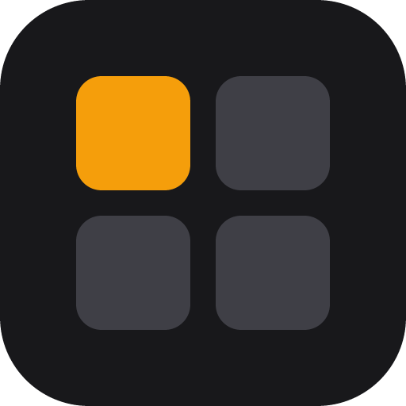
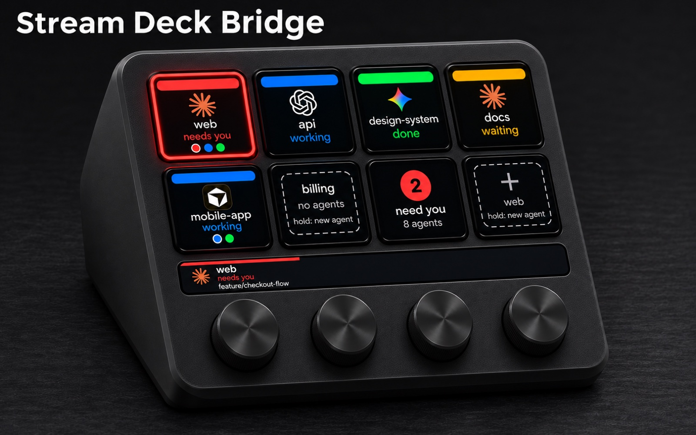
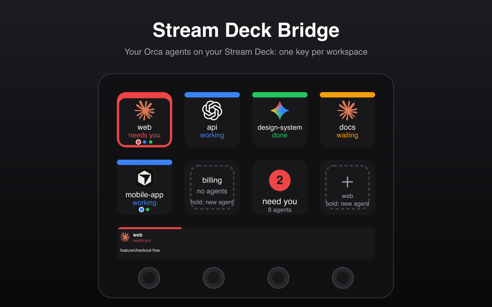

<div align="center">



<h1>Stream Deck Bridge for Orca</h1>

<p>
<b>Your Orca coding agents on an Elgato Stream Deck.</b><br>
One key per workspace, coloured by what its agent is doing. Tap a key to go to that agent, hold it to start a new one, and never miss the one that is waiting for you.
</p>

<p>
<a href="https://github.com/crilofer/orca-streamdeck/releases/latest"></a>


<a href="LICENSE"></a>
</p>

<p>
<a href="#install">Install</a> ·
<a href="#what-you-get">What you get</a> ·
<a href="#using-it">Using it</a> ·
<a href="#permissions">Permissions</a> ·
<a href="#known-limits">Limits</a> ·
<a href="#how-it-works">How it works</a>
</p>



</div>

Stream Deck Bridge is a plugin for [Orca](https://github.com/stablyai/orca). It shows every
agent's state on your Stream Deck and lets you act on it from there.

> [!IMPORTANT]
> It comes in two halves that you install together: this plugin in Orca, and the **Orca Deck**
> plugin in the Stream Deck app.

## What you get

| Action | Where | What it does |
| --- | --- | --- |
| **Agent** | key | One workspace per key: the project's name, the agent's logo and its state. Tap to go to it, hold to start a new agent there. |
| **Needs you** | key | How many agents are waiting for you. Tap to go to the most urgent one. |
| **Agents dial** | dial and touch strip (Stream Deck +) | Turn to browse every agent; the strip shows its project, state and branch. Push to go to it. |

Orca's status bar also shows how many agents need you.

## Install

The two halves connect to each other by themselves: there is no port, address or pairing code to
enter. The only setup is choosing which workspace each key shows.

**1. In Orca** (1.4.261 or newer). Plugins are in alpha; turn them on in **Settings → Plugins** first.

```sh
orca plugin install crilofer/orca-streamdeck
```

The plugin runs its own code, so Orca asks you to approve it and prints the exact command to
re-run with `--approve <fingerprint>`.

**2. In the Stream Deck app** (6.6 or newer). Download `com.crilofer.orca.streamDeckPlugin`
from the [latest release](https://github.com/crilofer/orca-streamdeck/releases/latest), open
it, and confirm the install. The actions appear under the **Orca Deck** category.

To update, run `orca plugin update --all` in Orca and install the new `.streamDeckPlugin` from
the release: the deck plugin does not update by itself, and installing it over the old one keeps
your keys and their settings.

To uninstall, run `orca plugin list` to find the plugin's key and `orca plugin uninstall <key>`,
then uninstall **Orca Deck** from the Stream Deck app.

> [!NOTE]
> Orca and the Stream Deck app must run on the same machine, under the same user. Tested on macOS
> with a Stream Deck +; Windows and other Stream Deck models should work but are untested.

## Using it



### Agent key

Drag **Agent** onto a key and, in its settings, choose a **Workspace** and which agent
**Hold to start** launches (Claude Code by default).

The key shows the project's name, the agent's logo and its state. The bar along the top is the
state's colour:

| Colour | State | Meaning |
| --- | --- | --- |
| red | needs you | The agent stopped until you answer it. |
| amber | waiting | The same, as other agents report it. |
| blue | working | The agent is busy. |
| green | done | The agent finished. |

Red and amber both mean the agent is waiting for you. Which one you see depends on the agent:
Orca reports Claude Code's permission prompts and questions as waiting, and some other agents'
as needs you.

- **Several agents in one workspace.** The key shows one at a time: whoever stopped working most
  recently (the newest while all are working), or the one you picked. A row of dots along the
  bottom has one dot per agent, up to eight, in its state's colour, with the shown one outlined.
- **Tap** goes to the agent on the key and, on macOS, brings Orca in front of other apps. With
  several agents, a tap while Orca already shows that workspace steps to the next one.
- **Hold** (a little over half a second) starts a new agent in that workspace and brings its tab
  to the front in Orca. The key shows it at once and confirms with a check mark.
- **A coloured frame** around a key marks the agent currently selected on the deck, the one the
  dial's strip describes.
- **No agents** in the workspace: the key says so; tap opens the workspace, hold starts an agent.
- **A key with no workspace** shows a plus sign: hold it to start an agent in whichever workspace
  Orca is showing.
- **Orca offline** means Orca is not running or the plugin is disabled there. Keys come back by
  themselves.

### Needs you key

A count of the agents that need you or are waiting, red or amber accordingly. When none do, it
shows how many are working, or that all are done. Tap goes to the most urgent agent.

### Agents dial (Stream Deck +)

Turn the dial to move through every agent in every workspace, most urgent first. The touch
strip shows the selected agent's logo, project and state, and its branch or worktree name, which
the keys leave out. Turning only selects: push the dial or tap the strip to go to the agent.

## Permissions

Orca asks you to approve these when you install the plugin:

| Permission | What the plugin uses it for |
| --- | --- |
| Runs its own code (trusted worker) | Listening on `127.0.0.1` for the Stream Deck plugin and writing the pairing file. |
| Agent status | Listing each workspace's agents and following their state. |
| Read workspaces | The project and workspace names on the keys, and which workspace Orca is showing. |
| Change workspaces | Opening a workspace and bringing an agent's terminal to the front when you tap. |
| Start agents | Starting an agent when you hold a key. |

The Orca plugin stores nothing in Orca, opens no connection to the internet, and the only file it
writes is the pairing file described under [How it works](#how-it-works). The Stream Deck plugin
talks only to the bridge; its settings pages load Elgato's `sdpi-components` script from
`sdpi-components.dev`.

## Known limits

- Hold always starts the agent chosen in the key's settings: Orca does not let a plugin open its
  own "new agent" dialog, where you would pick one.
- Only on macOS does a press bring Orca's window in front of other apps. Orca does not let a
  plugin raise its window, so the Stream Deck plugin does it itself, and only knows how there.
- Anything running as your user on this machine can read the pairing file and connect, which is
  the same reach the `orca` CLI already has.
- `agent.status.changed` is marked experimental by Orca; its payload may still change.

## How it works

```
Orca agents ──events──▶ Stream Deck Bridge (this plugin) ◀───TCP on 127.0.0.1────▶ Orca Deck (Stream Deck plugin)
                                   │                                                  │
                           workspace.open, agent.launch, terminal.focus           keys & dials
```

The Orca plugin asks Orca for the agents of every workspace when it starts (`agents.list`) and
keeps that roster current from Orca's events (`agent.status.changed`). It orders it attention
first, pushes each change to connected decks, and runs what a deck asks for: open a workspace, go
to an agent's terminal, launch an agent. The command **Stream Deck: bridge status**
(also behind the status bar item) tells you the port and how many decks are connected.

### Finding the bridge and pairing

The bridge listens on a free port the system picks, so there is none to configure or to clash
with. It writes `~/.orca-streamdeck/bridge.json` (readable by your user only) with that port and
a token it generated for this run, and removes it when it stops.
The Stream Deck plugin reads that file each time it connects, so no port or token is
ever entered on the deck. This is the only file the plugin writes, and it means Orca and the
Stream Deck app must run on the same machine under the same user.

A client's first line must be `{"type":"auth","token":"…"}`. Until then the bridge says
nothing, and a wrong token or any line it does not understand closes the connection. That is
what keeps out a web page, which can post to a loopback port but cannot read the file.

<details>
<summary><b>Protocol</b></summary>

One JSON object per line, both directions. Types live in `src/bridge-protocol.ts`, which the
Stream Deck plugin imports as-is.

Server → deck:

| Message | When |
| --- | --- |
| `hello` | Once the client has authenticated: protocol version and plugin id/version. |
| `snapshot` | After `hello`, on request, and whenever the focused workspace changes: every agent, every workspace Orca knows, and `focusedWorkspaceId`, the one Orca's window shows (null when unknown). |
| `agent` | An agent's status changed. |
| `agent.removed` | Its workspace was removed, or the `agent` message just before it gave the agent its pane's key in place of a `terminal:<id>` one. |
| `result` | Answer to a request that carried an `id`. |

Deck → server:

| Message | Effect |
| --- | --- |
| `snapshot` | Ask for a fresh snapshot. |
| `open { workspaceId }` | Show that workspace in Orca. |
| `launch { workspaceId, agent, prompt? }` | Start an agent CLI there, with an optional first prompt. The result carries `terminalId`, and an `agent` message for it (state `working`, pane `terminal:<id>` until the agent reports) follows at once. |
| `focus { terminalId }` | Bring that terminal's tab and pane to the front in Orca. The result carries `focused`, false when a newer request won or Orca's window did not move. |

Each agent carries `paneKey`, `workspaceId`, `terminalId`, `title`, `agent` (kind, once known),
`state`, `outcome` and `since` (when the current state began). Each workspace carries `id`,
`name`, `project` (null when Orca names none), `path`, `branch` and `kind`.

Workspace ids are the ones `workspace.list` gives, which `open` and `launch` accept. Orca's events
also carry a raw id; the bridge uses their `workspaceListId` and the `workspaceId` of
`workspace.readContext`, so a deck never sees the raw form.

</details>

## Develop

<details>
<summary><b>Building, testing and talking to the bridge by hand</b></summary>

The Orca plugin, at the repository root:

```sh
pnpm install            # TypeScript and Node typings, for the editor and `pnpm typecheck`
pnpm types              # writes Orca's plugin typings to .orca/types (gitignored)
pnpm validate
pnpm test
pnpm dev                # loads this folder into Orca, prints logs, reloads on save
```

Fake an agent event without a real agent:

```sh
orca plugin dev emit . agent.status.changed --data '{"workspaceId":"w1","paneKey":"p1","terminalId":"t1","title":"Claude","state":"blocked","receivedAt":1}'
```

Talk to the bridge by hand:

```sh
cat ~/.orca-streamdeck/bridge.json      # {"port":52814,"token":"…"}
nc 127.0.0.1 52814
{"type":"auth","token":"…"}
{"type":"snapshot","id":"1"}
```

The Stream Deck plugin, in [`streamdeck/`](streamdeck/) (needs the Stream Deck app 6.6+ and
`npm i -g @elgato/cli`):

```sh
cd streamdeck
pnpm install
pnpm run deploy     # build, copy into the Stream Deck app's plugin folder, restart the plugin
pnpm test
pnpm typecheck
```

Agent logos come from Orca: a few as SVG paths in `streamdeck/src/agent-logos.ts`, the rest as the
PNG favicons Orca bundles, copied into `streamdeck/agent-icons/` and inlined by `pnpm icons:agents`.

`pnpm run deploy` installs a copy instead of `streamdeck link`ing this folder on purpose: the Stream
Deck app writes its logs into the plugin folder, and a symlink into this repo would put them
inside the Orca plugin's development folder, whose watcher reloads the bridge on every write.
Logs are therefore in the installed copy, `logs/` under
`~/Library/Application Support/com.elgato.StreamDeck/Plugins/com.crilofer.orca.sdPlugin` on
macOS or `%APPDATA%\Elgato\StreamDeck\Plugins\...` on Windows. To hand the plugin to someone,
`pnpm run pack` writes a `.streamDeckPlugin` installer to `streamdeck/dist/`.

</details>

## Roadmap

- Agent terminal preview on the deck's screen via `terminal.read`.

## License

[MIT](LICENSE). The agent logos in `streamdeck/agent-icons/` are trademarks of their owners and are not covered by it.
